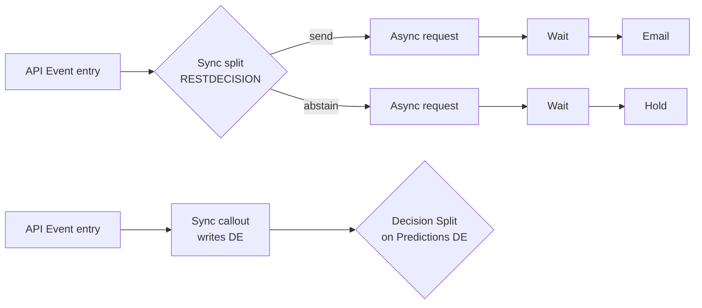

# Custom Activities User Guide

How to build a Journey Builder custom activity that calls an external model, and what an
external API owner should expect on the wire. The worked example is the **Expedia
Saturation Model**, which decides send vs. abstain. Everything here applies to any
REST-backed custom activity.

- [1. Mental model](#1-mental-model)
- [2. Is the outbound schema guardrailed?](#2-is-the-outbound-schema-guardrailed)
- [3. The three activity patterns in this repo](#3-the-three-activity-patterns-in-this-repo)
- [4. API contract (for the external consumer)](#4-api-contract-for-the-external-consumer)
- [5. Building a custom activity step by step](#5-building-a-custom-activity-step-by-step)
- [6. config.json reference](#6-configjson-reference)
- [7. Security: JWT verification](#7-security-jwt-verification)
- [8. Testing without Marketing Cloud](#8-testing-without-marketing-cloud)
- [9. Troubleshooting](#9-troubleshooting)

---

## 1. Mental model

A custom activity is a web app that you host. Journey Builder knows about it through a
single `config.json` URL, which you register as a *Journey Builder Activity* component on an
installed package. Journey Builder then makes these calls:

| When | Call | Purpose |
|---|---|---|
| Marketer drags the activity onto the canvas | `GET {endpoint}/config.json` | Learns name, type, arguments, schema, outcomes |
| Marketer opens the activity | `GET {endpoint}/index.html` in an iframe | Config UI, talks to JB via Postmonger |
| Journey saved / validated / published / stopped | `POST /save`, `/validate`, `/publish`, `/stop` | Lifecycle hooks; just return 200 |
| **Each contact reaches the activity** | **`POST /execute`** | **The real call. One request per contact.** |

```mermaid
sequenceDiagram
  participant JB as Journey Builder
  participant API as Your API (/ca/sync)
  participant DE as Contact Data (DE)
  JB->>API: POST /execute (JWT: inArguments + journey ids)
  API-->>JB: 200 {branchResult, ...outArguments}
  Note over JB: RESTDECISION routes by branchResult;<br/>outArguments → {{Interaction.KEY.field}}
  API--)DE: (optional) async upsert of prediction row
```

## 2. Is the outbound schema guardrailed?

**Short answer: partly.** Journey Builder fixes the *envelope* of each call, but most of
the *payload* is yours to design.

### What you control (effectively free-form)

- **inArguments, which Journey Builder sends to you.** You choose any names and any
  number. Values are data-binding expressions such as `{{Contact.Key}}`,
  `{{Event.<eventKey>.Field}}`, `{{Contact.Attribute.<DE>.<Field>}}`, or literals.
  Journey Builder resolves them per contact before calling you, so **every value arrives
  as a string or a scalar, already resolved**. Nested objects are not data-bound.
- **outArguments, which you return.** You choose any names. Declare each one in
  `schema.arguments.execute.outArguments` so marketers can use it later as
  `{{Interaction.<activityKey>.<name>}}`.
- **Response body.** Any JSON object. Journey Builder reads only the keys it cares
  about (`branchResult` and the declared outArguments) and ignores the rest.
- **Lifecycle bodies.** Return anything with HTTP 200.

### What Journey Builder fixes (the guardrails)

| Guardrail | Rule |
|---|---|
| Transport | HTTPS on port 443. `POST` with a JSON body, or a JWT string if `useJwt: true` |
| Request envelope | Always sent by Journey Builder: `inArguments[]`, `outArguments[]`, `activityObjectID`, `journeyId`, `activityId`, `definitionInstanceId`, `activityInstanceId`, `keyValue`, `mode`. **You cannot remove these or rename them.** |
| inArguments shape | Array of single-key objects: `[{"a":"…"},{"b":"…"}]`, not one object |
| Success | HTTP **200**. Any non-2xx counts as a failure for that contact |
| `timeout` | 1,000–100,000 ms (default 20,000). The troubleshooting docs say **60 s max per activity in practice**; this repo uses 10 s (sync) and 5 s (async) |
| `retryCount` | 0–5 (default 0) |
| `retryDelay` | 0–10,000 ms (default 1,000) |
| `concurrentRequests` | **1–10** (default 6) parallel calls per activity. This caps your throughput, so size your API for it |
| outArguments values | **Must not be null.** Return `""` or `0` instead. This repo always returns `reasonCodes` as `""` when there are none |
| outArgument types | The `dataType` in the schema must be a Journey Builder / Data Extension type. Salesforce's examples use `Text`, `Number`, `Date`, `Email`, `Phone`, and this repo also uses `Decimal`. Salesforce publishes no exhaustive list, so stick to DE field types |
| Split activities (`RESTDECISION`) | The response **must** contain `branchResult`, and it **must exactly equal** one outcome's `arguments.branchResult`. Otherwise the contact errors out of the journey |
| Data binding | Case-sensitive. Renaming or removing an outArgument that is referenced downstream breaks journey publish |

> Source: Salesforce Developers, *Create Custom Activity Configuration*,
> *Troubleshoot Custom Activities*, *Data Binding*, *Example REST Activity*.

**So to answer the question directly:** an external API consumer can design its own
request fields and response fields. It must accept the Journey Builder envelope (and
ignore fields it doesn't recognize, since Salesforce may add more), return 200 within
the timeout, never return null for a declared outArgument, and, for splits, return a
`branchResult` that matches a configured outcome key exactly.

## 3. The three activity patterns in this repo

| | Sync split | Sync callout | Async (fire-and-forget) |
|---|---|---|---|
| config `type` | `RESTDECISION` | `RESTDECISION` (single outcome) | `REST` |
| Endpoint | `/ca/sync/execute` | `/ca/sync/execute` with inArg `mode=callout` | `/ca/async/execute` |
| Journey waits for the answer? | Yes | Yes | No |
| Who picks the path | `branchResult` (`send` / `abstain`) | A following **Decision Split** on Contact Data | A following Wait + Decision Split on Contact Data |
| Prediction lands in | Response (outArguments) + DE in background | DE **before** the response returns | DE later (REST upsert or S3 → Import) |
| Use when | The model answers fast (< a few seconds) | You want the answer persisted and reusable as contact data | The model is slow or batch-oriented |



## 4. API contract (for the external consumer)

JSON Schemas live in [`docs/schemas/`](schemas). The prose summary follows.

### 4.1 Request: `POST /ca/{sync|async}/execute`

With `useJwt: true` (the default here), the raw HTTP body is a compact **HS256 JWT**
string. Decode and verify it as described in [§7](#7-security-jwt-verification). The
decoded payload looks like this:

```json
{
  "inArguments": [
    { "contactKey": "EXP-100231" },
    { "threshold": "0.6" }
  ],
  "outArguments": [],
  "activityObjectID": "8c2f…",
  "journeyId": "b4784…",
  "activityId": "a1b2…",
  "definitionInstanceId": "d3c4…",
  "activityInstanceId": "e5f6…",
  "keyValue": "EXP-100231",
  "mode": 0,
  "iat": 1793667750,
  "exp": 1793668050
}
```

inArguments used by this repo:

| Activity | inArgument | Type | Required | Notes |
|---|---|---|---|---|
| sync | `contactKey` | Text | ✔ | `{{Contact.Key}}` |
| sync | `threshold` | Text (number 0–1) | | Overrides the model's global abstain threshold |
| sync | `mode` | Text | | `callout` switches to the callout pattern |
| async | `contactKey` | Text | ✔ | |
| async | `delaySec` | Text (0–45) | | Simulated model latency |
| async | `cdcMode` | Text | | `rest` \| `s3` \| `both`: how the result returns to MCE |

Values arrive as **strings**, even numbers, because they are data-bound. Parse them on
your side.

### 4.2 Responses

**Sync split** ([schema](schemas/sync-execute-response.schema.json)):
```json
{ "branchResult": "abstain", "prediction": "abstain", "saturationScore": 0.773,
  "reasonCodes": "HIGH_SEND_VOLUME_7D|HIGH_SEND_VOLUME_30D|DECLINING_OPEN_RATE",
  "modelVersion": "sat-gbm-2026.10.3" }
```
Downstream these are available as `{{Interaction.SAT-SYNC.saturationScore}}`, and so on.

**Sync callout** ([schema](schemas/callout-execute-response.schema.json)):
```json
{ "branchResult": "written", "status": "written", "prediction": "send", "saturationScore": 0.304 }
```

**Async** ([schema](schemas/async-execute-response.schema.json)):
```json
{ "status": "accepted" }
```

**Lifecycle** (`save` / `validate` / `publish` / `stop`): `{ "success": true }`.

**Errors.** `401 {"error":"JWT signature invalid"}` (or `"JWT expired"`), and
`500 {"error":"…"}`. Journey Builder treats any non-2xx as a failure and retries up to
`retryCount`.

### 4.3 Out-of-band write-back ([schema](schemas/prediction-row.schema.json))

The async and callout patterns, plus background persistence from the sync pattern, upsert this row into the
`Expedia_Saturation_Predictions` Data Extension (primary key `SubscriberKey`) through
`POST /hub/v1/dataevents/key:{DE}/rowset`. The same columns go into CSV for the S3 → Import
path.

| Field | DE type | Example |
|---|---|---|
| `SubscriberKey` (PK) | Text(50) | `EXP-100231` |
| `SaturationScore` | Decimal(6,3) | `0.773` |
| `Prediction` | Text(10) | `send` \| `abstain` |
| `ReasonCodes` | Text(255) | `HIGH_SEND_VOLUME_7D\|DECLINING_OPEN_RATE` |
| `RecommendedHoldHours` | Number | `52` (0 when send) |
| `ModelVersion` | Text(50) | `sat-gbm-2026.10.3` |
| `ScoringMode` | Text(20) | `sync` \| `async` \| `callout` \| `event` \| `batch` \| `console` |
| `ScoredAt` | Text(40) | ISO-8601 UTC |
| `JourneyId`, `ActivityId` | Text(100) | from the request envelope |

### 4.4 Reason codes

`HIGH_SEND_VOLUME_7D`, `HIGH_SEND_VOLUME_30D`, `DECLINING_OPEN_RATE`, `LOW_CLICK_THROUGH`,
`DAYS_SINCE_ENGAGEMENT`, `UNSUBSCRIBE_INTENT`, `UPCOMING_TRIP_RELEVANCE`,
`ONE_KEY_{SILVER|GOLD|PLATINUM}_TOLERANCE`. At most 4 are returned, ordered by contribution.

## 5. Building a custom activity step by step

1. **Host the app over HTTPS.** This repo runs on AWS Lambda behind an API Gateway HTTP
   API (`deploy/deploy.sh`). Any HTTPS host works.
2. **Serve `config.json` at `{endpoint}/config.json`.** Here the server renders it
   (`src/activities.mjs`) so every URL inside it matches the live host.
3. **Create an installed package** in MCE (Setup → Apps → Installed Packages):
   - Add a **Journey Builder Activity** component. Set its Endpoint URL to
     `https://<host>/ca/sync/` (and add a second component for `/ca/async/`).
   - Copy the package's **JWT Signing Secret** into `MCE_JWT_SECRET`.
   - Copy each component's unique key into `MCE_CA_SYNC_KEY` / `MCE_CA_ASYNC_KEY`.
     The journey-by-API scripts use these keys as `applicationExtensionKey`.
4. **Build the config UI** (`src/public/ca/{sync,async}/index.html` and `activity.js`).
   On `initActivity`, read the existing inArguments. On `clickedNext`, write
   inArguments, set `metaData.isConfigured = true`, and trigger `updateActivity`.
5. **Implement `/execute`.** Verify the JWT, flatten inArguments, do the work, and return
   200 with `branchResult` (for splits) and every declared outArgument (never null).
6. **Implement the lifecycle hooks.** Return 200 from `/save`, `/validate`, `/publish`,
   `/stop`. Use `/validate` to reject bad configuration before publish.
7. **Add it to a journey.** Use the canvas (it appears under *Flow Control* for splits,
   *Custom* for REST), or the Interaction API (`deploy/journey.py`, `deploy/journey_cd.py`).

## 6. config.json reference

Abbreviated from the live sync config:

```jsonc
{
  "workflowApiVersion": "1.1",
  "type": "RESTDECISION",                 // REST = no branching; RESTDECISION = custom split
  "metaData": { "icon": "icon.png", "category": "flow", "isConfigured": false },
  "lang": { "en-US": { "name": "Expedia Saturation Check (Sync)", "description": "…" } },
  "arguments": {
    "execute": {
      "inArguments": [{ "contactKey": "{{Contact.Key}}" }],   // defaults; the UI overwrites them
      "outArguments": [],
      "url": "https://<host>/ca/sync/execute",
      "verb": "POST", "format": "json", "useJwt": true,
      "timeout": 10000, "retryCount": 1, "retryDelay": 1000, "concurrentRequests": 5
    }
  },
  "configurationArguments": {             // lifecycle hooks
    "save":     { "url": "https://<host>/ca/sync/save",     "verb": "POST", "useJwt": true },
    "publish":  { "url": "…/publish",  "verb": "POST", "useJwt": true },
    "validate": { "url": "…/validate", "verb": "POST", "useJwt": true },
    "stop":     { "url": "…/stop",     "verb": "POST", "useJwt": true }
  },
  "outcomes": [                            // RESTDECISION only; branchResult must match the response
    { "key": "send",    "arguments": { "branchResult": "send" },    "metaData": { "label": "Send" } },
    { "key": "abstain", "arguments": { "branchResult": "abstain" }, "metaData": { "label": "Abstain (saturated)" } }
  ],
  "schema": {                              // types + visibility for data binding
    "arguments": { "execute": {
      "inArguments":  [{ "contactKey":      { "dataType": "Text",    "isNullable": false, "direction": "in" } }],
      "outArguments": [{ "saturationScore": { "dataType": "Decimal", "direction": "out", "access": "visible" } }]
    } }
  },
  "wizardSteps": [{ "label": "Configure", "key": "step1" }],
  "userInterfaces": { "configModal": { "height": 520, "width": 720 } }
}
```

`access: "visible"` exposes the outArgument in later expression builders. `hidden` (or
leaving `access` unset) hides it.

## 7. Security: JWT verification

With `useJwt: true`, Journey Builder signs the body using **HS256** and the installed
package's **JWT Signing Secret**. Verify it as follows (see `src/jwt.mjs`):

1. Split the body into `header.payload.signature`.
2. Compute `HMAC-SHA256(secret, header + "." + payload)`, base64url-encode it, and compare
   in constant time.
3. Reject the request if `exp` has passed.
4. Return 401 on failure.

`src/jwt.mjs` also accepts the base64-decoded form of the secret, to tolerate how
different packages store it. Plain JSON bodies are accepted unverified so you can test
locally; **in production, reject unsigned bodies.**

## 8. Testing without Marketing Cloud

```bash
node dev.mjs                         # http://localhost:8787, in-memory store, no AWS needed
curl -s localhost:8787/ca/sync/config.json | jq .type
curl -s -XPOST localhost:8787/ca/sync/execute \
  -d '{"inArguments":[{"contactKey":"EXP-100231"}],"keyValue":"EXP-100231"}'
# → {"branchResult":"abstain","prediction":"abstain","saturationScore":0.773,...}

# Signed request (set MCE_JWT_SECRET=testsecret before starting dev.mjs to enforce verification)
node -e 'const c=require("crypto"),b=x=>Buffer.from(JSON.stringify(x)).toString("base64url");
const h=b({alg:"HS256",typ:"JWT"}),p=b({inArguments:[{contactKey:"EXP-100234"}],exp:Math.floor(Date.now()/1e3)+300});
console.log(h+"."+p+"."+c.createHmac("sha256","testsecret").update(h+"."+p).digest("base64url"))' \
 | curl -s -XPOST localhost:8787/ca/sync/execute --data-binary @-
```

Seeded contact keys run from `EXP-100231` to `EXP-100238`. Any unknown key gets a stable
synthetic profile, so real journey contacts still score.

## 9. Troubleshooting

| Symptom | Likely cause |
|---|---|
| Activity tile shows "configuration required" | The UI never set `metaData.isConfigured = true`, or `config.json` isn't valid JSON (watch for a BOM) |
| Contacts error out of a split | `branchResult` is missing or doesn't exactly match an outcome's `arguments.branchResult` |
| Journey won't publish | A downstream `{{Interaction.KEY.field}}` references an outArgument that was renamed or removed |
| Intermittent 5xx or timeouts at volume | Too many `concurrentRequests` for your backend. Raise `timeout` / `retryCount` or scale the API |
| 401 from `/execute` | Wrong `MCE_JWT_SECRET` (it must come from the same installed package as the activity component) |
| Decision split after the callout sees stale data | Upsert the DE **before** responding (the callout pattern does this) |
| `journeyhistory/search` returns nothing | Use the per-version `definitionId`, not the interaction id |
